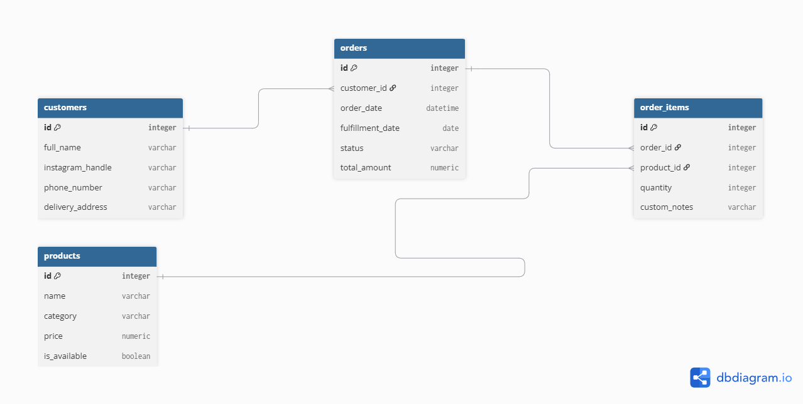

# Design Document: Social Kitchen & Order Manager

By Nagham Kakish

Video overview: https://youtu.be/onetqXTbK8A?si=xImiTj8IW15Q-wEg

## Scope

- **What is the purpose of your database?**
  The purpose of this database is to streamline operations for small, home-based food businesses (such as Instagram bakeries and meal-prep pages) that traditionally manage orders, customer details, and kitchen prep through scattered direct messages and manual notebooks. It centralizes order tracking, customer information, and menu catalogs to prevent missed orders and communication errors.

- **Which people, places, things, etc. are you including in the scope of your database?**
  The database includes customers and their contact/delivery details, product menu items and categories, order headers tracking fulfillment dates and statuses, and individual order items mapping quantities and custom customer notes (such as personalized messages or dietary requests).

- **Which people, places, things, etc. are *outside* the scope of your database?**
  External elements like payment gateway processing, automated delivery driver routing, raw ingredient inventory management (such as tracking grams of flour or sugar), and staff user accounts/permissions are outside the scope of this project.

## Functional Requirements

- **What should a user be able to do with your database?**
  A user should be able to register new customers, add and update menu items, record new orders placed via DMs or messages, link multiple products to an order with specific quantities and custom notes, update order fulfillment statuses (e.g., Pending, Out for Delivery, Completed), and automatically generate daily baking prep lists.

- **What's beyond the scope of what a user should be able to do with your database?**
  A user cannot process online credit card transactions, track delivery driver GPS locations, or automatically deduct raw stock inventory from a pantry supply table when an order is placed.

## Representation

### Entities

- **Which entities will you choose to represent in your database?**
  The database represents four main entities: `customers`, `products`, `orders`, and `order_items`.

- **What attributes will those entities have?**
  - `customers`: `id`, `full_name`, `instagram_handle`, `phone_number`, `delivery_address`
  - `products`: `id`, `name`, `category`, `price`, `is_available`
  - `orders`: `id`, `customer_id`, `order_date`, `fulfillment_date`, `status`, `total_amount`
  - `order_items`: `id`, `order_id`, `product_id`, `quantity`, `custom_notes`

- **Why did you choose the types you did?**
  `INTEGER` is used for primary and foreign keys for efficient integer indexing. `TEXT` is used for names, handles, addresses, and status indicators. `NUMERIC` is chosen for financial prices and totals to ensure precision with currency. `DATETIME` and `DATE` are used for timestamps and fulfillment tracking. `BOOLEAN` is used for availability flags.

- **Why did you choose the constraints you did?**
  `PRIMARY KEY` and `AUTOINCREMENT` are enforced on all entity IDs to ensure unique row identification. `NOT NULL` constraints are placed on mandatory fields like customer names, product prices, and fulfillment dates to prevent incomplete data entry. Foreign key constraints with reference links maintain relational integrity between orders, customers, and order items.

### Relationships

- **Entity Relationship Diagram:**

- **Describe the relationships between the entities in your database:**
  - **One-to-Many (`1:N`) between `customers` and `orders`**: A single customer can place many orders over time, but each order belongs to exactly one customer.
  - **Many-to-Many (`M:N`) between `orders` and `products`**: An order can contain multiple products, and a product can appear in many orders. This relationship is resolved using the `order_items` junction table, which connects via two One-to-Many relationships (`orders` to `order_items`, and `products` to `order_items`).

## Optimizations

- **Which optimizations (e.g., indexes, views) did you create? Why?**
  - **Indexes**: Created `idx_orders_fulfillment_date` on the `orders` table to drastically speed up daily schedule queries and kitchen prep lookups. Created `idx_orders_customer_id` to optimize pulling a customer's order history.
  - **Views**: Created a view named `daily_baking_list` that joins `orders`, `order_items`, and `products` to automatically aggregate total product quantities needed for active fulfillment dates, saving the baker from manual table scans.

## Limitations

- **What are the limitations of your design?**
  - The design assumes a single-currency environment and does not support multi-currency transactions.

- **What might your database not be able to represent very well?**
  - It cannot represent dynamic raw material inventory depletion (e.g., tracking how many kilograms of butter or chocolate are left in storage when a batch of brownies is ordered), as it focuses strictly on finished product menu sales and order fulfillment.
